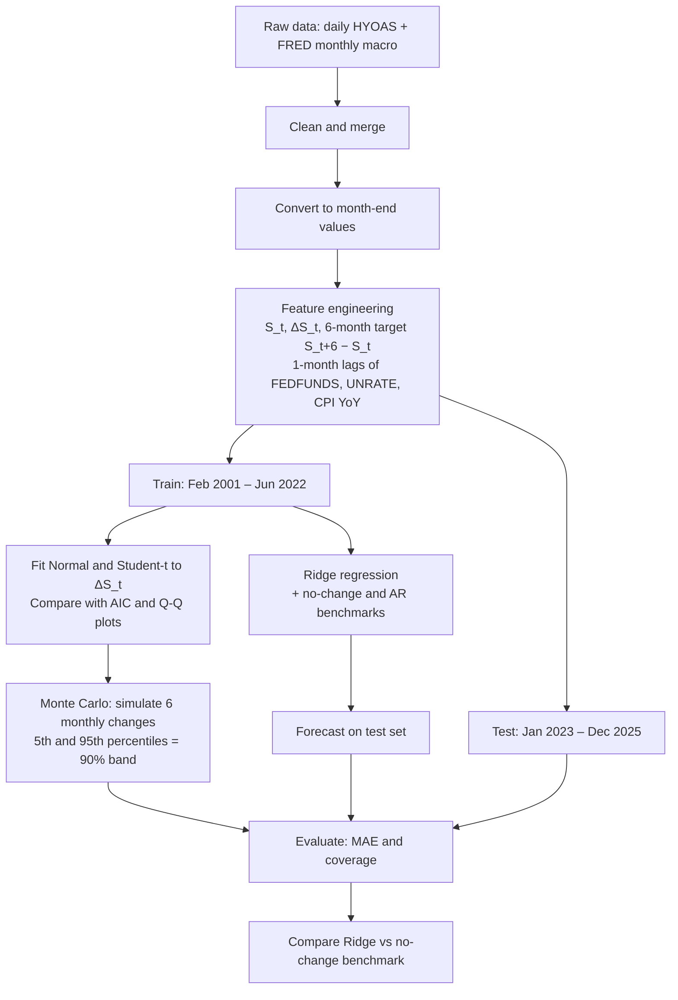

# Probabilistic Credit Spread Forecasting: Embedding Empirical Distribution Structure into Machine Learning Architecture.
Forecasting the US high-yield option-adjusted spread (HYOAS) six months ahead, comparing a Ridge regression against simple benchmarks, and using a fitted distribution of spread changes to express forecast uncertainty.

Course: DS603 Probability for Economics, 
Master of Data Science for Economics (MDSE), 
Singapore Management University 
    
_Team: LIM Shihan, Madhurima Subramaniam Rudra_

## 1. Project Overview

Credit spreads measure the extra yield investors demand for holding risky corporate bonds over Treasuries. A wide spread signals stress; a narrow spread signals calm markets. This project asks:

How well do Normal and Student-(t) models describe the distribution and tail risk of six-month credit-spread changes?

How accurately do their simulated prediction intervals capture realized changes?

## 2. Data
   
| Series | Source | Code | Frequency | Use |
| --- | --- | --- | --- | --- |
| ICE BofA US High Yield OAS | Macrotrends CSV | `BAMLH0A0HYM2` | Daily → month-end | Target and spread features |
| Federal funds rate | FRED | `FEDFUNDS` | Monthly | Predictor (lagged 1 month) |
| Unemployment rate | FRED | `UNRATE` | Monthly | Predictor (lagged 1 month) |
| CPI | FRED | `CPIAUCSL` | Monthly | Predictor: year-on-year inflation (lagged 1 month) |
| Commodity index | FRED | `PALLFNFINDEXM` | Monthly | Available, not used in current model |
| WTI oil price | FRED | `POILWTIUSDM` | Monthly | Available, not used in current model | 

Raw files live in data/raw/. Do not edit them; all cleaning happens in the notebook.

## 3. Method
   
### 3.1 Notation
$S_t$ = HYOAS at the end of month $t$, in percentage points (e.g. 3.50 means 350 bp)
$S_t - S_{t-1}$ = one-month change

### 3.2 Target
$$y_t = S_{t+6} - S_t$$

This is the six-month change in the spread. Because $S$ is already in percentage points, multiplying by 100 gives basis points, so $100 \times y_t$ is the widening (positive) or narrowing (negative) in bp.

### 3.3 Predictors 
| Feature | Definition | Reason |
| --- | --- | --- |
| $S_t$ | Current spread level | Captures the current risk environment and possible mean reversion |
| $\S_t - S_{t-1}$ | One-month spread change | Captures short-run persistence or reversal |
|S_{t+6}| Six-month spread change | |
| `Fed_Rate%_L1` | Lagged policy rate | Tight policy tends to raise credit risk |
| `Unemp_Rate%_L1`| Lagged unemployment | Labour market weakness signals default risk |
| `CPI_yoy_L1`| (CPIt-1 / CPIt-13) - 1 | Inflation environment; year-on-year removes seasonality | 
|`GCI_yoy_L1`| (GCIt-1 / GCIt-13) - 1| Global Commodity Index |

The one-month lag ensures no information is used that would not be available on the forecast date.

### 3.4 Distribution
Fit Normal and Student-t distributions using Maximum Likelihood Estimation (MLE).
Compare the fitted distributions against the empirical data.
Use AIC and Q-Q plots to evaluate model fit.

### 3.5 Monte Carlo Simulation and Uncertainity bands
Simulate six independent monthly changes from the fitted distribution and sum them. Repeat 200,000 times for Normal and Student-t distributions
Extract the 5th and 95th percentiles to construct 90% prediction intervals.
Check interval width against actual six-month changes in the training data.

### 3.6 ML Model (Additional Analysis)
Ridge regression - Adds an L2 penalty $\lambda \sum_j \beta_j^2$ to ordinary least squares, which shrinks correlated coefficients and stabilises estimates with a small sample. Regularisation strength $\lambda$ is chosen by time-series cross-validation.
No-change benchmark: $\hat S_{t+6} = S_t$. The hardest simple baseline to beat for spreads.

## 4. Train / Test Split

| Set | Forecast origins | Target window | Observations |
| --- | --- | --- | --- |
| Training | Jan 2000 – Jun 2022 | Up to Dec 2022 | about 270 |
| Test | Jan 2023 – Dec 2025 | Jul 2023 – Jun 2026 | 36 |

Training ends in June 2022 so that every training target is observed before the test period starts. January–June 2026 are not used as origins, since their outcomes are not yet available. Financial-crisis and COVID observations are kept in training because they are informative stress episodes.

## 5. Evaluation Metric
   ### 5.1 Akaike Information Criteria
   AIC scores a fitted distribution by how well it explains the data, penalised for the number of parameters: $\text{AIC} = 2k - 2\ln(\hat{L})$. We use it to pick between Normal and Student-t for the spread changes, since lower is better and the penalty stops the more flexible model winning by default.

   ### 5.2 Q-Q Plots
   A Q-Q plot compares the sample quantiles of the spread changes with the theoretical quantiles of the fitted distribution. Points on the 45° line mean a good fit, and departures in the tails show whether fat tails are being missed, which matters for stress periods like 2008 and COVID.

   ### 5.3 Coverage
   Coverage is the share of actual six-month changes that fall inside the 90% prediction interval. It should be close to 90%; much lower means the bands are too narrow and understate risk, much higher means they are too wide to be useful.

   ### 5.4 Mean Absolute Error
   Mean Absolute Error (MAE): MAE is the average absolute gap between the forecast and the actual six-month change, in basis points: $\text{MAE} = \frac{1}{n}\sum_t |\hat{y}_t - y_t|$. It is easy to read and is compared against the no-change benchmark, since beating a no-change forecast is the real test for a spread model.

## 6. Analysis and Summary of Findings

### 6.2 Summary of findings
1. Credit-spread changes exhibit heavy-tailed behaviour.
2. Student-t provides a better fit than Normal.
3. The Monte carlo simulations gave 100% coverage but were very wide (650 - 680) bps when the actual was only around 300bps.
4. The test period was relatively calm compared with the training period, which led to conservative boundaries.
5. Compared with the unconditional bands, Ridge is tighter (574 bps).
6. 6 month spread changes are often relatively small outside major stress periods, which favours the more conservative forecasts produced by a moving average model. 
7. Recent spread dynamics provided more useful predictive information than the selected lagged macroeconomic variables during this partocular test period

_Detailed interpretations given along side code in the Jupyter notebook_

### 6.3 Limitations
1. Only 36 test observations, with overlapping six-month horizons. Hence only 6 independent time periods for testing.
2. Monte Carlo assumes monthly changes are independent and identically distributed. But a Variance ratio of 1.247 suggests the independence assumption may be imperfect.
3. Normal and Student-t distributions may not fully capture asymmetric tail behaviour.
4. The omission of autoregressive (AR) lags, which may leave unaccounted temporal dependencies and serial correlation in the time series.

## 6. Repository Structure
.
├── README.md
├── DS603_Project.ipynb        # Main analysis notebook (Colab)
├── data/
│   ├── raw/                   # Original downloads, unedited
│   └── processed/             # Month-end and merged monthly data
├── outputs/
│   ├── EDA/                   # Trend Analysis, Box plots
│   └── figures/               # QQ-plots, forecast charts, interval plots
└── requirements.txt           # Python dependencies

## 7. Setup
   
bash
git clone <REPO_URL>
cd <REPO_NAME>
pip install -r requirements.txt

Or open DS603_Project.ipynb directly in Google Colab. The notebook clones the data from this repository.

Key packages: pandas, numpy, scipy, statsmodels, scikit-learn, matplotlib, seaborn.

## 8. References
Links:
HY-OAS: https://www.macrotrends.net/3006/high-yield-spread
U.S. Macroeconomic Indicators: https://fred.stlouisfed.org/
